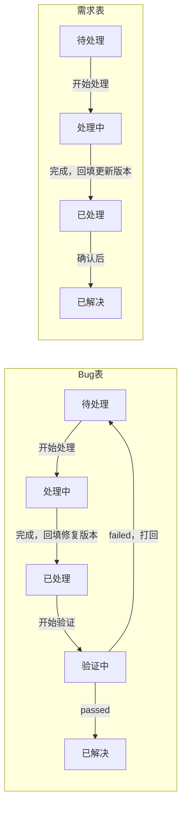

# 需求表和 Bug 表：状态、选项与流程

截至 2026-10-30 核对：需求表 48 行，Bug 表 85 行。两张表的状态选项相同。

## 1. 字段

需求表 8 列，Bug 表 11 列。两张表共用 id、标题、模块、状态、测试结果、备注。

| 字段 | 需求表 | Bug 表 | 说明 |
| --- | --- | --- | --- |
| id | 有，R-xx | 有，B-xx | 自动编号，新增行时自动生成，不手填 |
| 标题 | 有 | 有 | 一句话描述 |
| 模块 | 有，多选 | 有，多选 | 见第 2 节 |
| 需求内容 | 有 | 无 | 要做什么 |
| 复现步骤 | 无 | 有 | 怎么重现 |
| 当前现象 | 无 | 有 | 实际看到的结果 |
| 预期现象 | 无 | 有 | 应该是什么结果 |
| 状态 | 有 | 有 | 见第 2、3 节 |
| 更新版本 | 有 | 无 | 需求完成时的版本号 |
| 发生版本 | 无 | 有 | Bug 最早出现的版本 |
| 修复版本 | 无 | 有 | 修复所在的版本 |
| 测试结果 | 有，但没有使用 | 有 | passed 或 failed |
| 备注 | 有 | 有 | 根因、实现细节、待办 |

## 2. 选择项

两张表的状态、测试结果、模块选项相同。模块是多选，状态和测试结果是下拉。

- **状态**（下拉）：待处理、处理中、已处理、验证中、已解决
- **测试结果**（下拉）：passed、failed
- **模块**（多选）：仪表盘、明细、统计、记一笔、汇率换算、设置、我的账户、登录注册、底部导航、全局、其他
- **版本号**（更新版本、发生版本、修复版本）是自由文字，不是下拉。现有写法不统一，例如 `washi-ledger 0.0.0-20260825-dev.2`、`0.0.0-20261015-dev.1`、`20261013-dev.3`、`dev.1`。

CLAUDE.md 写 Bug 表的模块是下拉，实际是多选，以表的设置为准。

## 3. 流程

### 现行规则（CLAUDE.md）

- **需求**：待处理 → 处理中（开始处理时改）→ 已处理（处理完毕时改，并回填「更新版本」）
- **Bug**：待处理 → 处理中 → 已处理（回填「修复版本」）→ 验证中 → 测试结果 failed 则打回待处理；passed 则改为已解决

### 实际做法（按当前数据）

- **需求表**：当前没有一行处于「验证中」，也没有填测试结果。
- **Bug 表**：已解决 56 行中，50 行有 passed，6 行没有测试结果。已处理 25 行、验证中 4 行，都没有测试结果。

### 状态流程图

测试失败会打回待处理，只有 passed 才会进入已解决。需求表目前没有验证步骤，已处理后确认为已解决。

## 4. 当前状态核对（2026-10-30）

需求表（共 48 行）：

| 状态 | 行数 |
| --- | --- |
| 已解决 | 36 |
| 已处理 | 10 |
| 处理中 | 2 |
| 待处理、验证中 | 0 |

Bug 表（共 85 行）：

| 状态 | 行数 | 有测试结果 | 没有测试结果 |
| --- | --- | --- | --- |
| 已解决 | 56 | 50（passed） | 6 |
| 已处理 | 25 | 0 | 25 |
| 验证中 | 4 | 0 | 4 |
| 待处理、处理中 | 0 | 0 | 0 |

需要核对的行：

- **已处理 25 行**：B-57 到 B-70，以及 B-75 到 B-85。其中 B-57 到 B-63 的修复版本在 10-04 和 10-05，仍是「已处理」。
- **验证中 4 行**：B-71 到 B-74，修复版本都是 0.0.0-20261015 系列。
- **已解决但没有测试结果 6 行**：B-51 到 B-56。
- **已解决但没有修复版本 1 行**：B-39（测试结果是 passed）。
- **需求表「处理中」2 行**：R-38 的备注写着等待新一轮设计确认，R-42 的备注写着尚未开始实现。

## 5. 待你确认

1. **需求表要不要用「验证中」和「测试结果」？** 要的话和 Bug 表一样走验证；不要的话流程写成 待处理 → 处理中 → 已处理 → 已解决，测试结果列留空。
2. **已处理的 25 行，哪些在真机上验过？** 验过的改成「已解决」，并填测试结果 passed。
3. **没有测试结果的 6 行（B-51 到 B-56）和没有修复版本的 B-39，要不要补上？**
4. **版本号统一成 `0.0.0-YYYYMMDD-dev.N` 吗？** 和 package.json 一致。旧记录不改，只规定以后的写法。
5. **R-38、R-42 是「处理中」，但备注说明没在做，要不要改回「待处理」？**
